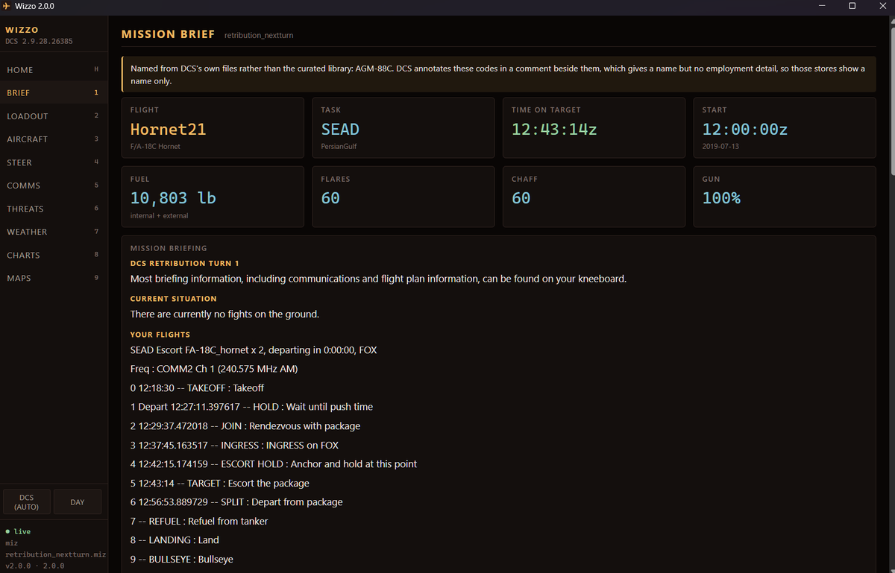
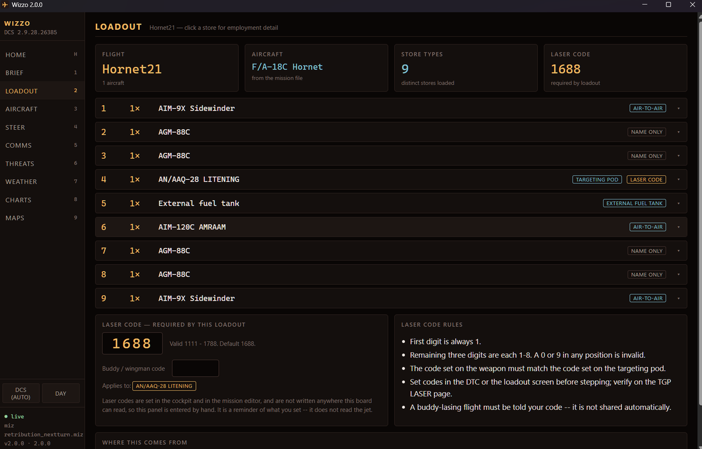
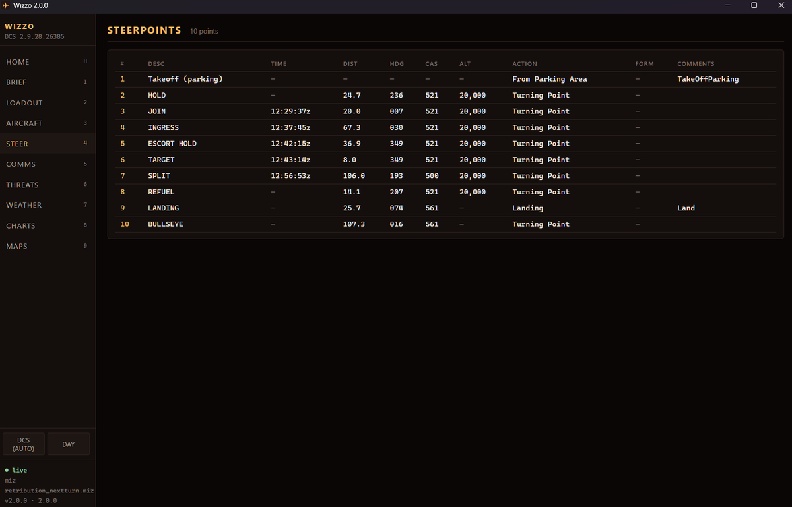

# Wizzo

A second-monitor kneeboard for **Falcon BMS**, **DCS World** and **IL-2
Sturmovik: Great Battles**. It reads the files the sim writes, matches the
charts, turns your loadout into an employment reference, and rebuilds when you
take a new mission.

Only want it on a tablet, as a service, headless or on Linux? Use
**[Wizzo Server](https://github.com/CyberM00/wizzo-server)**: the same board
without the desktop window. Both read the same files and show the same pages.



| | |
|---|---|
|  |  |
| **Loadout** | **Steer** |

## Running it

### Download (Windows)

1. Get the zip from [Releases](https://github.com/CyberM00/wizzo/releases) and
   unzip it anywhere.
2. Run **`Wizzo.exe`**. No Python needed; the board opens in its own window.
   **F11** toggles fullscreen.

Settings, map caches and the log go to `%LOCALAPPDATA%\Wizzo`; nothing is written
to the app folder.

Windows may warn that the publisher is unrecognised because the exe is not
code-signed. Choose *More info*, then *Run anyway*, or build it yourself (below).

The server keeps running behind the window, so a tablet or phone on your network
can open the address printed in `%LOCALAPPDATA%\Wizzo\wizzo.log`.

### From source

Requires Python **3.10+** (CI tests 3.10 and 3.13).

```bash
pip install -r requirements.txt
python wizzo.py
```

Or double-click **`start-wizzo.bat`** on Windows (arguments are passed through).
From source it opens a browser; drag it to your second monitor and press **F11**.
From source, settings and caches are written beside the checkout.

### Options

| Option | Effect |
|---|---|
| `--host` | Bind address (default `0.0.0.0`, all interfaces) |
| `--port` | Port (default `5000`) |
| `--bms-path`, `--dcs-path`, `--il2-path` | Override a game folder (also `BMS_PATH`, `DCS_PATH`, `IL2_PATH`) |
| `--no-browser` | Do not open a browser |
| `--window` / `--no-window` | Use the desktop window / a browser (default: window when packaged, browser from source; `--window` needs `pywebview` from `requirements-build.txt`) |
| `--no-update` | Skip the update check |
| `--check-update` | Report whether an update is waiting, then exit |

### Network access

The board serves on all interfaces so a tablet can reach it, which means anyone
on that network can read your mission. There is no authentication or TLS; use it
only on a network you trust. To restrict it to this machine:

```bash
python wizzo.py --host 127.0.0.1
```

It only ever reads; it cannot change game files.

## Game folders

All three sims are found automatically (BMS and DCS from the registry, IL-2 from
Steam's library list, then a scan of the usual folders).

If one is missed, the **Game folders** panel appears on first run, and later under
**Change game folders** on the Home page. Each row takes a path (the packaged app
has a **Browse…** button), **Find it** (automatic) or **Not installed**. Changes
apply immediately.

A folder is accepted only if it contains `Data\TerrData` (BMS),
`Mods\terrains` (DCS) or `data\Swf.gtp` (IL-2).

Priority: command line, environment, saved setting, automatic discovery.

```bash
python wizzo.py --bms-path "D:\Falcon BMS 4.38"
```

## Updates

- **Packaged build:** checks GitHub for a newer release and shows a link in the
  sidebar. It never downloads or replaces anything itself.
- **Git clone:** fast-forwards from GitHub on every start and relaunches. Skipped,
  with the reason printed, when there are uncommitted changes, unpushed commits,
  or GitHub is unreachable. A copied (not cloned) folder shows `not auto-updating`.
  If `requirements.txt` changed, run `pip install -r requirements.txt` again.

The version and commit are shown at the bottom of the sidebar.

## Using the board

The board opens on a **sim chooser** showing each sim's status and current
mission. Click one to pin the board to it, or cycle the button under the nav to
`(auto)` to follow whichever sim wrote a mission most recently. The board checks
for a new mission every two seconds.

| Page | Contents |
|---|---|
| **Home** | Sim chooser |
| **Brief** | Flight, package, TOT, target, situation, roster, ROE, emergency procedures |
| **Loadout** | Stores with weights, missile ranges and employment detail; laser-code panel |
| **Aircraft** | IL-2: limits, engine modes and settings from game data. BMS/DCS: the aircraft manual |
| **Steer** | Steerpoint table: time, distance, heading, CAS, altitude, action, formation |
| **Comms** | Comm ladder, UHF/VHF presets, IFF, Link 16 |
| **Threats** | Air and surface threats, support assets with TACAN channels |
| **Weather** | Conditions at takeoff, target and landing |
| **Charts** | Approach plates for departure, recovery, alternate and target fields; all KTO airfields browsable |
| **Maps** | BMS theatre maps; DCS and IL-2 charts with your route drawn on |

| Key | Action |
|---|---|
| `1`-`9` | Switch page |
| `H` | Sim chooser |
| `R` | Force reload |
| `T` | Toggle theme (Amber night / Paper day), stored per device |

Portrait screens get a top nav and a taller chart viewer.

## What each sim provides

### BMS

| Data | Source |
|---|---|
| Brief, steerpoints, comms, IFF, Link 16, weather, ordnance | `User\Briefings\briefing.txt` |
| UHF/VHF presets | `User\Briefings\dtc_comm.txt` |
| Weapon weights, missile ranges | `Data\TerrData\Objects\Falcon4_WCD.xml` |
| Approach plates, airfield diagrams | `Docs\03 KTO Charts\` |
| Theatre maps | `Docs\05 Maps\` |
| Employment guidance, fuzing, laser applicability | `bmskb/data/f16_stores.json` (curated) |

- Laser codes are entered by hand (BMS does not export them), validated as `1xyz`
  with each digit 1-8.
- Bomb ranges and guidance types are not shown from game data (WCD values are
  placeholders); the curated library covers them.
- Radio presets are flagged as stale if `dtc_comm.txt` and `briefing.txt` differ
  by more than five minutes.
- Tank weights are dry weights.
- Other theatres work if their `Docs` tree follows the same layout.
- Employment notes are planning guidance, not certified release tables.

### DCS support

Read from the mission `.miz`.

| Page | Contents |
|---|---|
| Brief | Briefing text, airframe, task, theatre, date, times, fuel, flares, chaff, gun |
| Loadout | Every station; employment detail for curated stores |
| Steer | Route with altitudes, speeds, ETAs, leg distance and bearing |
| Comms | Preset channels per radio, tanker and AWACS frequencies |
| Weather | Clouds, wind at three altitudes, visibility, temperature, QNH |
| Charts | Kneeboard pages embedded in the `.miz` (e.g. by Retribution) |
| Maps | The terrain's own raster chart (`Mods\terrains\<terrain>\RasterCharts`), cropped to the mission, with route, airfields and bullseye |
| Threats | Not shown |

- Weapon names are curated for the **F/A-18C, A-10C and AV-8B N/A** only; other
  stores show their raw CLSID.
- No weights, ranges or threat picture (DCS provides no reliable source).
- Wind is converted to "from" direction.
- Only tanker and AWACS groups are listed as support.
- Stitched charts are cached in `dcs_map_cache/`. If a chart cannot be placed or
  is missing, a land/water outline with a graticule is shown instead.

### IL-2 support

Career mode is fully supported; scripted DLC campaigns partially (briefing text,
briefing map and as-flown loadout only). PWCG missions are ignored.

| Page | Contents |
|---|---|
| Brief | Title, callsign, airframe, date, takeoff time, briefing, roster, fuel and ammo |
| Loadout | Store names from the game's own tables; planned vs as-flown |
| Steer | Route with altitudes, speeds, formations, leg distance and bearing (no ETAs) |
| Comms | Callsigns only |
| Weather | Five wind layers, clouds, temperature, pressure, haze, turbulence, sea state |
| Charts | Taxi diagrams for departure and recovery fields |
| Maps | The sim's planner map with your route |
| Threats | Not shown |

- Weapon names are cached in `il2_name_cache.json` and rebuild after a game patch.
- The as-flown loadout comes from `data\missionReport(...)[0].txt`, which needs
  `mission_text_log = 1` in `data\startup.cfg` (on by default).
- Weapon modifications and gun round counts are not shown. Wind direction is shown
  as the file states it.

## Development

```bash
pip install -r requirements.txt -r requirements-build.txt
python -m pytest
python packaging/build.py    # builds and zips the packaged app
```

Flask and Pillow are needed to run from source; PyInstaller and pywebview only to
build the package. Entry point is `wizzo.py`; parsers live in `bmskb/` (`dcs/`
and `il2/` per sim), the desktop window in `bmskb/desktop.py`, packaging in
`packaging/`. See [CONTRIBUTING.md](CONTRIBUTING.md).

## Support

If this saved you time, you can [buy me a coffee](https://ko-fi.com/cyberm00).
